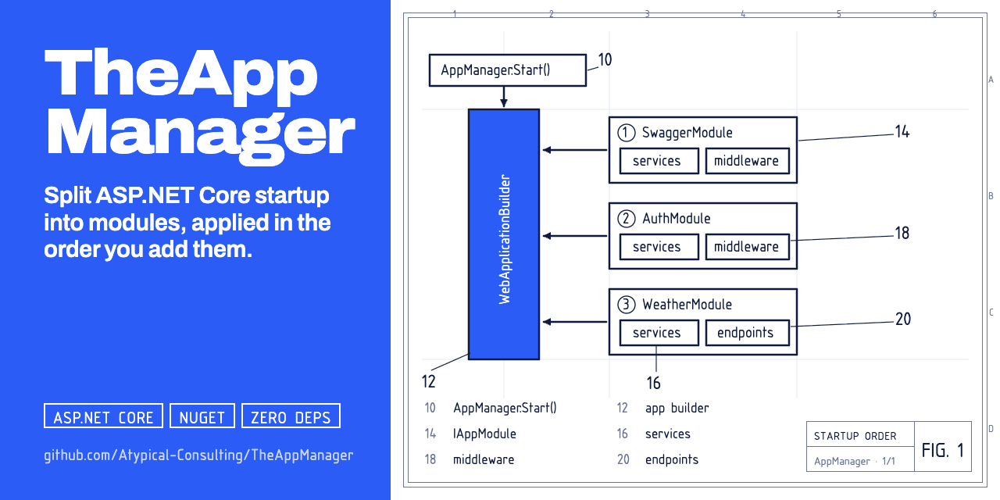

<p align="center">
  
</p>

# TheAppManager

> A lightweight, composable module system for ASP.NET Core application startup.

[](https://github.com/phmatray/TheAppManager/actions/workflows/ci.yml)
[](https://www.nuget.org/packages/TheAppManager)
[](https://opensource.org/licenses/MIT)

## Table of Contents

- [Overview](#overview)
  - [Architecture](#architecture)
  - [Why Modules?](#why-modules)
- [Installation](#installation)
- [Quick Start](#quick-start)
- [Creating Modules](#creating-modules)
  - [A Minimal Module](#a-minimal-module)
  - [Module Ordering](#module-ordering)
  - [Conditional Modules](#conditional-modules)
- [Assembly Scanning (opt-in)](#assembly-scanning-opt-in)
- [Testing](#testing)
  - [Integration Testing with AppModuleTestHost](#integration-testing-with-appmoduletesthost)
  - [Replacing Modules in Tests](#replacing-modules-in-tests)
  - [Replacing modules under WebApplicationFactory](#replacing-modules-under-webapplicationfactory)
- [Async Support](#async-support)
- [Builder Configuration Hook](#builder-configuration-hook)
- [Advanced: Using AppManagerBuilder](#advanced-using-appmanagerbuilder)
- [Project Structure](#project-structure)
- [Contributing](#contributing)
- [License](#license)

## Overview

TheAppManager lets you organize your ASP.NET Core startup into independent, composable **modules**. Each module encapsulates its own services, middleware, and endpoints — keeping `Program.cs` clean and making features reusable across projects.

### Architecture

```
                    ┌──────────────────────┐
                    │   AppManager.Start() │
                    └──────────┬───────────┘
                               │
                    ┌──────────▼───────────┐
                    │  AppManagerBuilder    │
                    │  ┌─────────────────┐ │
                    │  │ WebApplication  │ │
                    │  │ Builder         │ │
                    │  └─────────────────┘ │
                    └──────────┬───────────┘
                               │ applies in registration order
              ┌────────────────┼────────────────┐
              │                │                │
    ┌─────────▼──────┐ ┌──────▼───────┐ ┌──────▼───────┐
    │ SwaggerModule  │ │  AuthModule  │ │ WeatherModule│
    │ ├ Services     │ │ ├ Services   │ │ ├ Services   │
    │ └ Middleware   │ │ └ Middleware  │ │ └ Endpoints  │
    └────────────────┘ └──────────────┘ └──────────────┘
```

### Why Modules?

As ASP.NET Core applications grow, `Program.cs` accumulates unrelated service registrations, middleware, and endpoint mappings. Modules solve this by letting each feature own its startup logic:

- **Composable** — add, remove, or reorder modules without touching other code
- **Reusable** — package a module in a NuGet library and share it across projects
- **Testable** — each module can be tested in isolation with `AppModuleTestHost`
- **Transparent ordering** — modules run in the order you register them, just like middleware

## Features

- **Composable modules** — encapsulate services, middleware, and endpoints into independent `IAppModule` implementations
- **Registration-order execution** — modules are applied in the order you add them, no magic priority numbers
- **Opt-in assembly scanning** — discover modules explicitly with `AddFromAssemblyOf<T>()` / `AddFromAssembly(assembly)`
- **Conditional registration** — add modules only when conditions are met with `AddIf<T>(bool)`
- **Module replacement** — swap modules for test doubles with `Replace<TOld, TNew>()`
- **Test host** — `AppModuleTestHost` builds a TestServer from modules for integration testing
- **Fluent API** — chain module registrations for readable startup code
- **Async support** — run applications asynchronously with `StartAsync` and `RunAsync`
- **Builder hook** — customize `WebApplicationBuilder` before modules are applied
- **Minimal dependencies** — built on the `Microsoft.AspNetCore.App` framework reference, plus `Microsoft.AspNetCore.TestHost`, which backs `AppModuleTestHost` and ships with the package

## Installation

```bash
dotnet add package TheAppManager
```

## Usage

Clone the repository and run the bundled sample, which wires up `SwaggerModule`, `AuthModule`, and `WeatherModule` through `AppManager.Start`:

```bash
dotnet run --project samples/TheAppManager.Sample
```

This starts an ASP.NET Core app with Swagger UI (in development) and a `/weatherforecast` endpoint, each contributed by its own `IAppModule` — no logic in `Program.cs` beyond the module list. In your own project, the minimal integration looks like:

```csharp
using TheAppManager.Startup;

AppManager.Start(args, modules =>
{
    modules
        .Add<SwaggerModule>()
        .Add<AuthModule>()
        .Add<WeatherModule>();
});
```

See [Creating Modules](#creating-modules) below for how to implement `IAppModule`.

## Quick Start

Register modules explicitly in `Program.cs`:

```csharp
using TheAppManager.Startup;

AppManager.Start(args, modules =>
{
    modules
        .Add<SwaggerModule>()
        .Add<AuthModule>()
        .Add<WeatherModule>();
});
```

Or let TheAppManager discover modules automatically:

```csharp
using TheAppManager.Startup;

AppManager.Start(args);
```

## Creating Modules

### A Minimal Module

Implement `IAppModule` and override only what you need. All methods have default no-op implementations:

```csharp
using TheAppManager.Modules;

public class SwaggerModule : IAppModule
{
    public void ConfigureServices(WebApplicationBuilder builder)
    {
        builder.Services.AddEndpointsApiExplorer();
        builder.Services.AddSwaggerGen();
    }

    public void ConfigureMiddleware(WebApplication app)
    {
        if (app.Environment.IsDevelopment())
        {
            app.UseSwagger();
            app.UseSwaggerUI();
        }
    }
}
```

A module that only registers endpoints:

```csharp
public class WeatherModule : IAppModule
{
    public void ConfigureServices(WebApplicationBuilder builder)
    {
        builder.Services.AddScoped<WeatherForecastService>();
    }

    public void ConfigureEndpoints(IEndpointRouteBuilder endpoints)
    {
        endpoints.MapGet("/weatherforecast", (WeatherForecastService svc) =>
            Results.Ok(svc.GetForecasts()));
    }
}
```

Note that `ConfigureServices` receives `WebApplicationBuilder` (not just `IServiceCollection`), giving you access to `builder.Configuration`, `builder.Environment`, and `builder.Host` when you need them.

### Module Ordering

Modules are applied in **registration order** — the order you call `Add<T>()`. This is the same principle as ASP.NET Core middleware: what you register first runs first.

```csharp
AppManager.Start(args, modules =>
{
    modules
        .Add<SwaggerModule>()    // services & middleware first
        .Add<AuthModule>()       // auth middleware second
        .Add<WeatherModule>();   // endpoints last
});
```

### Conditional Modules

Use `AddIf<T>()` to register modules based on runtime conditions:

```csharp
var isDev = builder.Environment.IsDevelopment();

AppManager.Start(args, modules =>
{
    modules
        .AddIf<SwaggerModule>(isDev)
        .Add<AuthModule>()
        .Add<WeatherModule>();
});
```

The `configure` callback runs before the `WebApplicationBuilder` exists. To decide from the environment or configuration, pass a predicate; it runs once, when the app is built, against the real builder (after any `ConfigureBuilder` callbacks):

```csharp
AppManager.Start(args, modules => modules
    .AddIf<SwaggerModule>(b => b.Environment.IsDevelopment()));
```

A module swapped in with `Replace<TOld, TNew>()` keeps the predicate of the module it replaces.

## Assembly Scanning (opt-in)

Nothing is discovered implicitly: `AppManager.Start(args, configure)` only registers what you add. To register every module of an assembly, scan it explicitly:

```csharp
AppManager.Start(args, modules =>
{
    // Scan the assembly containing Program (the anchor type need not be a module)
    modules.AddFromAssemblyOf<Program>();

    // Or scan a specific assembly, e.g. a referenced library
    modules.AddFromAssembly(typeof(SomeLibraryModule).Assembly);

    // Mix with explicit registration
    modules.Add<MyAppModule>();
});
```

What a scan picks up:

- Non-abstract, non-generic classes implementing `IAppModule` with a public parameterless constructor. `internal` modules are included; classes nested in a `private`, `protected` or `private protected` type are not. Modules that need constructor arguments are skipped: add them as instances.
- Modules are added sorted by ordinal `Type.FullName`, so order does not depend on reflection order. For order-sensitive applications, prefer explicit `Add<T>()`.
- Mark a module with `[ExcludeFromDiscovery]` to keep it out of scans; it can still be added explicitly. The attribute is not inherited.
- A scan that finds no module throws `InvalidOperationException` naming the assembly.
- Scanned modules follow the same identity rule as `Add`: a type registered twice (for example `Add<X>()` plus a scan that finds `X`) throws at resolve time unless the class has `[AllowMultipleInstances]`. Recorded `Replace` substitutions apply to scanned modules too. If the replacement type lives in the scanned assembly, mark it `[ExcludeFromDiscovery]`, or it is added twice.

Scanning uses reflection and is annotated `[RequiresUnreferencedCode]`: it is not trim- or Native AOT-safe. Prefer `Add<T>()` in trimmed or AOT apps.

## Testing

### Integration Testing with AppModuleTestHost

`AppModuleTestHost` builds a TestServer from your modules, making integration tests simple:

```csharp
using TheAppManager.Testing;

[Fact]
public async Task WeatherEndpoint_ReturnsForecasts()
{
    await using var host = await new AppModuleTestHost()
        .Add<WeatherModule>()
        .StartAsync();

    var client = host.GetTestClient();
    var response = await client.GetAsync("/weatherforecast");

    response.StatusCode.ShouldBe(HttpStatusCode.OK);
}
```

You can also resolve services directly:

```csharp
await using var host = await new AppModuleTestHost()
    .Add<WeatherModule>()
    .StartAsync();

var service = host.GetRequiredService<WeatherForecastService>();
```

### Replacing Modules in Tests

Use `Replace<TOld, TNew>()` to swap a real module for a test double:

```csharp
public class FakeAuthModule : IAppModule
{
    public void ConfigureServices(WebApplicationBuilder builder)
    {
        builder.Services.AddSingleton<IAuthService, FakeAuthService>();
    }
}

await using var host = await new AppModuleTestHost()
    .Add<AuthModule>()
    .Add<WeatherModule>()
    .Replace<AuthModule, FakeAuthModule>()
    .StartAsync();
```

### Replacing modules under WebApplicationFactory

To test the real app (`Program`) with a module swapped or removed, use `WithModules` on a
`WebApplicationFactory<Program>`. The amendment runs after `Program`'s own `AddModules` composition and
before the plan is resolved; chained calls apply in call order, and parallel factories stay isolated.

```csharp
using TheAppManager.Testing;

await using var factory = new WebApplicationFactory<Program>()
    .WithModules(m => m.Replace<SmtpModule, FakeSmtpModule>())
    .WithModules(m => m.Without<SwaggerModule>());

var client = factory.CreateClient();
```

`Program` must pass `args` to `WebApplication.CreateBuilder(args)`: the amendment reaches the app through
those arguments, and building the host throws `InvalidOperationException` when it was not applied. To swap
a single service rather than a module, use `WebApplicationFactory`'s own `ConfigureTestServices`.

## Async Support

Use `StartAsync` for async startup:

```csharp
await AppManager.StartAsync(args, modules =>
{
    modules
        .Add<SwaggerModule>()
        .Add<WeatherModule>();
});
```

## Builder Configuration Hook

Customize the `WebApplicationBuilder` before modules are applied:

```csharp
AppManager.Start(
    args,
    modules =>
    {
        modules
            .Add<SwaggerModule>()
            .Add<WeatherModule>();
    },
    builder =>
    {
        builder.Configuration.AddJsonFile("custom-settings.json", optional: true);
    });
```

## Advanced: Using AppManagerBuilder

For full control, use `AppManagerBuilder` directly:

```csharp
using TheAppManager.Modules;
using TheAppManager.Startup;

var modules = new AppModuleCollection()
    .Add<SwaggerModule>()
    .Add<AuthModule>()
    .Add<WeatherModule>();

var appManager = new AppManagerBuilder(args)
    .ConfigureBuilder(builder =>
    {
        builder.Configuration.AddJsonFile("custom-settings.json");
    })
    .Build(modules);

await appManager.RunAsync();
```

## Project Structure

```
src/TheAppManager/              → Class library (NuGet package)
samples/TheAppManager.Sample/   → Sample web app demonstrating usage
tests/TheAppManager.Tests/      → Unit and integration tests
```

<!-- portfolio-techstack:start -->

## Tech Stack

- **C#**
- Swashbuckle.AspNetCore
- Microsoft.AspNetCore.TestHost
- Microsoft.AspNetCore.Mvc.Testing
- Shouldly
- xunit
- xunit.runner.visualstudio

<!-- portfolio-techstack:end -->

## Roadmap

- [ ] Module dependency declarations (e.g. `DependsOn<T>()`) to enforce ordering automatically
- [ ] Health-check integration for modules that expose their own health endpoints
- [ ] Source-generator based auto-discovery to avoid runtime assembly scanning
- [ ] Additional samples (minimal API-only, Blazor Server) alongside the existing sample app
- [ ] Configuration validation hooks per module (fail fast on missing settings)
- [ ] v3: move `AppModuleTestHost` to a separate `TheAppManager.Testing` package so production apps no longer ship `Microsoft.AspNetCore.TestHost` (breaking change)

See the [open issues](https://github.com/Atypical-Consulting/TheAppManager/issues) for details and to propose new ideas.

## Contributing

1. Fork the repository
2. Create a feature branch (`git checkout -b feature/my-feature`)
3. Make your changes
4. Run tests (`dotnet test`)
5. Commit your changes (`git commit -am 'Add my feature'`)
6. Push to the branch (`git push origin feature/my-feature`)
7. Open a Pull Request

## License

[MIT](LICENSE)

<!-- portfolio-nugetkeep:start -->
---
Built by [Atypical Consulting](https://www.atypical.consulting). We also make
[NuGetKeep](https://nugetkeep.com/?utm_source=github-readme&utm_medium=readme&utm_campaign=launch-2026-07),
a self-hosted NuGet server with supply-chain quarantine.
<!-- portfolio-nugetkeep:end -->
